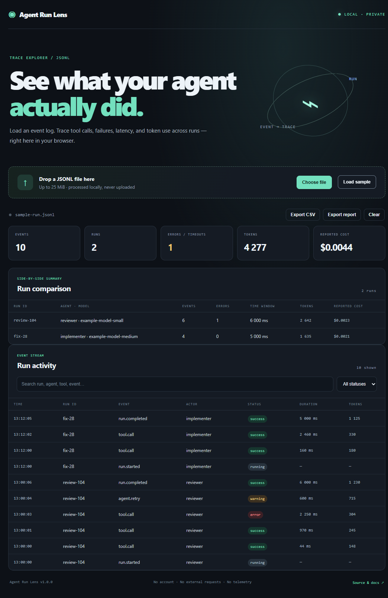
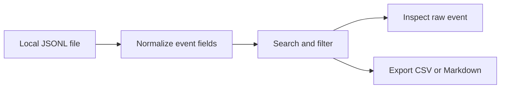

# Agent Run Lens

**A private, local-first JSONL explorer for AI agent run traces.** Search what agents and tools did, spot failed or slow events, review reported token and cost data, and export a compact report.

## Try it

Open the [live app](https://ghostnever-lkm.github.io/agent-run-lens/) or run `npm start` from this folder and open `http://127.0.0.1:8897/`. The app uses browser ES modules, so opening `index.html` directly with `file://` may be blocked by the browser.



Click **Load sample** to inspect a synthetic trace, or drop a `.jsonl` / `.ndjson` file. Files are limited to 25 MiB. Parsing happens in the current tab; the app has no account, analytics, upload endpoint, or external runtime dependency. Clear the session to release the parsed data from the page. The source and example are available in this repository.

## Event format

One JSON object per line. The minimum required fields are a parseable `timestamp` and an `event` name. Common aliases are accepted for event and metric fields.

```json
{"timestamp":"2026-10-10T09:12:00Z","run_id":"fix-28","event":"tool.call","agent":"implementer","model":"example-model","tool":"run_tests","status":"success","duration_ms":2460,"input_tokens":180,"output_tokens":150,"cost_usd":0.0021}
```

Recognized fields: `timestamp` (or `time`), `event` (or `name`), `run_id`, `agent`, `model`, `tool`, `status`, `duration_ms`, `input_tokens`, `output_tokens`, `tokens`, `cost_usd`, and `message`. Unknown fields remain available in the raw event detail. Invalid lines are skipped with line-numbered diagnostics. Search filters the normalized event fields; status filtering supports common success, failure, timeout, warning, and running values.

## Exports and limits

- **CSV** exports the currently filtered rows. Text that could be interpreted as a spreadsheet formula is prefixed before export.
- **Markdown report** contains the filtered event list and summary counts.
- Click a row to inspect normalized fields and the raw JSON record.
- When at least two run IDs are present, the comparison table shows each run's event count, failures, timestamp window, agent/model labels, token count, and reported cost separately. The time window is first-to-last record time, not summed event durations.
- Cost and token totals are shown only when the input supplies those values. The app does not estimate prices or infer missing usage.
- The summary counts each supplied duration field; when no duration is present, it uses the elapsed time between the earliest and latest records. This is not a wall-clock benchmark unless the source data represents a single run.
- Reported cost values are summed as supplied. If a trace repeats a cumulative run total on every event, the displayed sum will also be cumulative and may overcount.
- Agent Run Lens does not query a model provider, determine whether an agent's output is correct, or support proprietary binary trace formats.

## Development

Requires Node.js 20+. Run `npm start` to launch the small local static server; run `npm test` and `npm run check` for verification. The browser app itself has no build step or runtime package install.



## ☕ Support / Pro Version

Agent Run Lens is free software under the MIT license. Optional support: [Buy Me a Coffee](https://buymeacoffee.com/azizazimov8) · [Boosty](https://boosty.to/azizazimov).

Support by network, using only the matching chain and asset:

| Network | Address |
|---|---|
| TRON (TRC-20) | `TCBSy38X57hA6w2onJcxom24x1febc1mP1` |
| Bitcoin | `bc1qn75pj4n7gyl2k5kf2f97elvyenz52q6nn2g30u` |
| BNB Smart Chain | `0xD431a917961E0b086B96D9F72b5C8fF19b19068a` |

No separate paid add-on is offered in v1.0.0.

## License

MIT. See [LICENSE](LICENSE).
